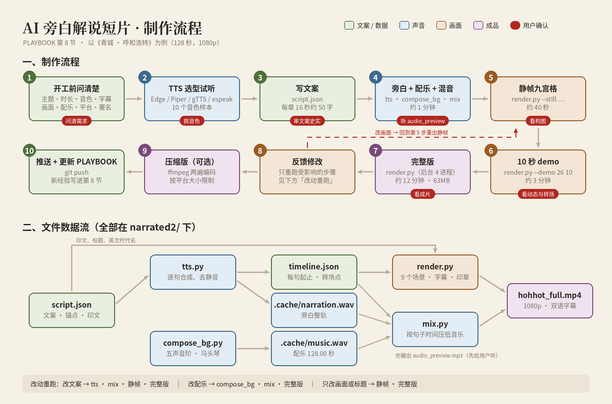

# 《星际回响》制作经验手册

用代码从零生成「配乐 + 黑洞动画」的完整流程、参数和踩过的坑，下次做类似作品时直接照着用。

---

## 1. 成品一览

| 文件 | 说明 |
|---|---|
| `music/stellar_echo.mp3` | 小调版（第一版，视频配乐用这个） |
| `music/stellar_echo_major.mp3` | 大调欢快版 |
| `music/stellar_echo_lyrical.mp3` | 慢速抒情版（60 BPM） |
| `video/stellar_echo_demo.mp4` / `_bw.mp4` | 10 秒 demo（彩色 / 黑白） |
| `video/stellar_echo_full_bw.mp4` | 完整 128 秒黑白版（81MB，高画质存档） |
| `video/stellar_echo_full_bw_30mb.mp4` | 压缩版 28.7MB（分享用） |
| `narrated2/hohhot_full.mp4` | 《青城 · 呼和浩特》128 秒 AI 旁白解说短片（见第 8 节） |
| `narrated2/hohhot_30mb.mp4` | 压缩版 28.6MB（发抖音、B 站、微信用） |
| `narrated2/hohhot_vertical.mp4` | 抖音竖版 1080×1920 |
| `narrated2/tts_samples/` | 10 种中文语音合成试听样本 |

## 2. 一键复现

```bash
pip install numpy scipy pillow        # 另需系统里有 ffmpeg
```

```bash
cd music && python3 compose.py && python3 compose.py major && python3 compose.py lyrical
```

```bash
cd video && python3 render_demo.py --still 7     # 先出静帧检查构图（首次约 2 分钟，含光线追踪）
```

```bash
cd video && python3 render_demo.py --bw          # 10 秒 demo；去掉 --bw 为彩色
```

```bash
cd video && python3 render_full.py --still 2 8 30 56 100 122   # 完整版关键帧预览
```

```bash
cd video && python3 render_full.py               # 完整 128 秒，4 进程约 6 分钟
```

压缩到 30MB 以内（两遍编码）：

```bash
ffmpeg -y -i stellar_echo_full_bw.mp4 -c:v libx264 -preset slower -b:v 1650k -pass 1 -an -f null /dev/null && ffmpeg -y -i stellar_echo_full_bw.mp4 -c:v libx264 -preset slower -b:v 1650k -maxrate 3500k -bufsize 7000k -pass 2 -pix_fmt yuv420p -c:a aac -b:a 128k -movflags +faststart out_30mb.mp4
```

码率估算：`目标大小(MB) × 8 ÷ 时长(秒) − 音频码率`，再留 5%~10% 余量。128 秒 / 30MB → 视频约 1650k。

---

## 3. 配乐（`music/compose.py`）

### 方法
- 纯 numpy 合成，不依赖音色库：管风琴（加法合成 + 两路微失谐）、钢琴（衰减泛音 + 轻微非谐性）、钢片琴、弦乐（3 路失谐锯齿波 + 低通）、低音、钟表滴答、定音鼓式低鼓。
- 混音：每个乐器一条轨，按比例送入一个公共混响（指数衰减噪声做卷积），最后 tanh 软限幅 + 归一化。
- 同一脚本用参数切换版本：`minor` / `major` / `lyrical`。

### 让时长「刚好」的技巧
- 选一个能整除的速度：**120 BPM × 4/4 → 每小节 2 秒 → 64 小节 = 128 秒**；抒情版 60 BPM → 32 小节。
- 段落按 8 小节划分，结构清楚，画面也好对齐。

### 「星际穿越」风格要素（只借鉴手法，旋律原创）
- 管风琴长音铺底、慢慢渐强；
- 贯穿全曲的钟表滴答（时间流逝感）；
- 重复的琶音 ostinato，后半段从 8 分音符加密到 16 分音符；
- 层层推进到高潮，再收回到最初的单薄配器。

### 好记的主旋律
- 8 小节、节奏简单（四分 + 少量八分），开头 3 个音走和弦分解（A–C–E），全曲重复 5 次以上。
- 和弦用流行进行：小调 Am–F–C–G，大调 C–G–Am–F。
- 改版本时**只换和声与音高，保留节奏型**，听众仍能认出是同一首。

### 自检
我（Claude）听不到声音，只能用数值检查：每 8 秒的 RMS 响度曲线应呈「安静前奏 → 渐强 → 高潮最响 → 回落」，峰值 < 0.9 不削波，时长精确 128.00 秒。最终听感要人来判断。

---

## 4. 黑洞动画（`video/render_demo.py`、`video/render_full.py`）

### 核心思路：光线只追踪一次
1. 对每个像素在史瓦西度规下追踪光线（等效牛顿形式加速度 `a = -1.5·h²·r̂ / r⁵`，史瓦西半径 = 1）。
2. 记录光线与吸积盘平面（y=0）的前 3 次交点 `(r, φ)`，以及逃逸方向。结果缓存到 `.trace_cache.npz`（77MB，已 gitignore）。
3. 每帧只做查表：盘面纹理按开普勒角速度 `ω ∝ r^-1.5` 旋转，多层交点按透明度前后合成。
→ 追踪 1920×1080 约 2 分钟，之后每帧只要零点几秒。

### 关键参数（改这些就能换风格）
| 参数 | 值 | 作用 |
|---|---|---|
| 相机仰角 `elev` | 7° | 越小越像电影里近乎侧视的卡冈图雅 |
| 相机距离 `dist` | 32 | 黑洞在画面中的大小 |
| 吸积盘 `RIN, ROUT` | 3, 13 | 内缘 = 最内稳定圆轨道 |
| 视场 | 50° | 构图松紧 |
| 盘面颜色 | 暖金 / 黑白 `--bw` | `col` 一行 |
| 星空透镜半径 `thE2` | 0.1² | 只让黑洞附近的星星弯曲 |

### 完整版如何「跟着音乐动」
- `BRIGHT`、`SPEED` 两条关键帧曲线对应音乐段落（前奏暗慢 → 高潮最亮最快 → 尾声回落）。
- 旋转用速度曲线的**积分**作为相位，变速时纹理不会跳。
- 从音频算每帧「瞬时响度 ÷ 1 秒平均响度」，快起慢落，作为亮度脉冲 → 低鼓一响光环就闪。
- 标题开头出现约 10 秒后淡出、结尾再现；Claude 标志一直留在右下角。

### 加速
- `multiprocessing` fork 4 个进程，各渲一段编码成独立 mp4，再用 ffmpeg concat 无损拼接并混入音频。
- 3840 帧 4 核约 6 分钟（单进程约 25 分钟）。长任务放后台跑。

### 工作流
**静帧 → 10 秒 demo → 关键帧预览图 → 完整版 → 压缩版**。每一步都先看图再继续，返工成本最低。

---

## 5. 踩过的坑

| 问题 | 原因 | 解决 |
|---|---|---|
| 星星被拉成短线 | 光线追踪远处步长大，逃逸方向有数值误差 | 星空不用追踪结果，改用点质量透镜公式 `β = θ(1 − θE²/θ²)` 在画面上解析映射 |
| 星空「假」 | 星星一样大、一样亮、太密 | 亮度服从幂律（大量暗星 + 少量亮星）、亮星加光晕、轻微色温差、淡银河 |
| 透镜让整个画面的星都弯曲、银河变成环 | 爱因斯坦环半径按物理值 0.25 rad 太大 | 收窄到 0.1 rad，只在黑洞附近变形（牺牲一点物理真实换简洁） |
| 黑白版里标志也变灰 | 灰度转换在叠加文字之后 | 先把画面转灰度，再叠加标题和 Claude 标志 |
| 黑白版标题偏暖 | 标题颜色是暖白 | 黑白版用中性白 |
| Claude 标志 | 没有官方文件，是手绘近似的星芒 | 有官方 logo 时替换 `overlay_layers()` 里的绘制代码 |

---

## 6. GitHub / 会话环境的坑

- **推送 403**：Claude 绑定的 GitHub 账号是 `zhaoyao75`，而 `hello-world` 属于另一个账号 `zhaoyao1975`，所以没有写权限，在 App 设置里也找不到那个仓库。→ 作品放在自己账号下的仓库（本仓库 `zhaoyao75/Colab-Code`）。
- 在会话中添加仓库时要用**推送权限**（push），只读克隆无法推送。
- 会话结束时有「未推送 / 未跟踪文件」检查：临时文件（`.trace_cache.npz`、`.seg_*`、`__pycache__`、`*.wav`）都要写进 `.gitignore`。
- 自动模式下 `git reset --hard` 这类不可逆操作会被拦截；需要撤掉本地提交时，改用「移到备份分支」的方式。
- 单个文件 GitHub 限制 100MB（超过 50MB 会警告）。完整视频 81MB 尚可，更长或更高清时考虑 Git LFS 或只提交压缩版。

---

## 7. 下次可以直接这样提需求

- 「参考 ×× 的风格，生成 N 秒、BPM 为 ××、调性 ×× 的配乐，主旋律要好记」——先说清楚时长、速度、情绪。
- 「先出静帧 / 10 秒 demo」——确认风格后再出完整版，省时间。
- 「彩色 / 黑白 / 标志保留颜色」「标题出现时间」「分享平台的大小限制」——一开始说明，可以少改几轮。
- 想换旋律或音色：改 `compose.py` 里的 `THEME` 和乐器函数；想换画面：改第 4 节的参数表。

---

## 8. 带 AI 旁白的解说短片（`narrated2/`《青城 · 呼和浩特》）

128 秒、1080p 横屏、中英双语字幕、AI 中文旁白、原创配乐、全程序化画面（无外部素材）。成品 `narrated2/hohhot_full.mp4`（约 63MB）。



流程图由 `narrated2/draw_workflow.py` 生成，流程有变化时改它再重跑。

### 8.1 开工前先问清楚（一次问完，少返工）

| 问题 | 这次的答案 | 说明 |
|---|---|---|
| 主题 / 内容 | 呼和浩特的前世今生 | 文案由 Claude 写，用户审 |
| 时长 | 128 秒 | 旁白排完要给片尾留 8~12 秒 |
| 旁白 | 中文、微软云健、正常语速、沉稳科普 | 先给 10 个音色的试听样本让用户挑 |
| 字幕 | 中英双语 | 中文在上、英文在下 |
| 画面 | 新做 | 历史题材 → 分章节的剪影风景 |
| 配乐 | 历史悠久风格，淡淡的，不盖过解说 | 说话时自动压低 |
| 平台 | 抖音、B 站、微信，横屏 16:9 | 用户后来说「先不用压缩」 |
| 标题 | 先给几个候选，用户定《青城 · 呼和浩特》 | 改标题只需重渲片头片尾 |

另外值得一开始就问：**片尾要不要署名**（这次用户不要「AI 旁白 / 代码生成」字样）、**标签和景点要不要标注**（这次最后用了印章）。

### 8.2 流程和每步耗时

| 步骤 | 命令 | 耗时 | 给用户确认什么 |
|---|---|---|---|
| ① TTS 选型试听 | 见 8.4 | 几分钟 | 挑音色 |
| ② 文案 | 编辑 `script.json` | — | 文案和史实措辞 |
| ③ 旁白 | `python3 tts.py` | 约 30 秒（要联网） | — |
| ④ 配乐 | `python3 compose_bg.py` | 约 30 秒 | — |
| ⑤ 混音 | `python3 mix.py` | 几秒 | `audio_preview.mp3`（**最先给用户听**） |
| ⑥ 静帧 | `python3 render.py --still 6 20 26.5 38.5 52 70.5 86 104 106.5` | 约 40 秒 | `stills/contact_sheet.jpg` 九宫格 |
| ⑦ 短 demo | `python3 render.py --demo 26 10` | 约 3 分钟 | 动态、转场、字幕节奏 |
| ⑧ 完整版 | `python3 render.py`（放后台跑） | 4 进程约 12 分钟 | 成片 |
| ⑨ 压缩版（可选） | 见第 2 节两遍编码（视频 1650k + 音频 128k，加 `-tune film`） | 约 4.5 分钟 | → `hohhot_30mb.mp4` 28.6MB，SSIM 0.98 |

全部在 `narrated2/` 目录下运行。环境准备：

```bash
pip install numpy scipy pillow edge-tts piper-tts && apt-get install -y fonts-noto-cjk espeak-ng
```

**改动只重跑受影响的步骤**：改文案 → ③⑤⑥⑧；改配乐 → ④⑤⑧；只改画面或标题 → ⑥⑧（改画面后只出相关时间点的静帧就够）。

### 8.3 文件和数据流

```
script.json ──tts.py──▶ timeline.json + .cache/narration.wav
                         │            compose_bg.py ──▶ .cache/music.wav
                         ├──mix.py（读 timeline 做闪避）──▶ .cache/final_audio.wav、audio_preview.mp3
                         └──render.py（读 timeline 定转场、字幕、盖章时间）──▶ hohhot_full.mp4
```

- `script.json`：标题、音色、语速；每章有 `id`、锚点时间 `start`、印文 `seal`、年份 `year`、英文时代名 `era_en`，以及若干 `[中文, 英文]` 句子。**改文案只改这一个文件。**
- `timeline.json`：每句旁白的起止时间、每章画面切换点（相邻两章旁白空隙的中点）。
- `.cache/`、`.seg_*` 是临时文件，已写进 `.gitignore`。

### 8.4 语音合成（TTS）

| 方案 | 中文音质 | 备注 |
|---|---|---|
| **Edge 神经语音（`edge-tts`）** | 最自然 | 免费、无需 key、要联网。云健 = 沉稳男声（纪录片），云希 = 年轻男声，云扬 = 播音腔，晓晓 / 晓伊 = 女声 |
| Piper（本地离线） | 能听懂，有机器味 | 模型从 huggingface `rhasspy/piper-voices` 下；`chaowen`、`xiao_ya` 还要装 `unicode_rbnf sentence_stream` |
| gTTS | 一般 | 不能调语速 |
| espeak-ng | 机器人音 | 只作占位 |
| OpenAI / ElevenLabs | — | 本环境没有 API key |

- **坑：Edge 在会话代理下报 `CERTIFICATE_VERIFY_FAILED`**。edge-tts 用的是 certifi 自带的证书，设 `SSL_CERT_FILE` 没用，要在代码里替换：`edge_tts.communicate._SSL_CTX = ssl.create_default_context(cafile="/root/.ccr/ca-bundle.crt")`（见 `tts.py`）。
- 逐句合成 → 去首尾静音 → 句间留 0.35 秒、章间至少 0.9 秒 → 按章节锚点排进时间线。按句缓存，没改的句子不会重新合成。
- 云健正常语速约每秒 4.5 个汉字。**每章 16 秒放 3~4 句、共 50 字左右**刚好，每句不超过 15 个字，字幕一行放得下。

### 8.5 配乐与混音

- `compose_bg.py`：D 羽调五声音阶，60 BPM × 32 小节 = 128 秒，每 4 小节（16 秒）对应一章。
  - 拉弦：用滑音、延迟揉弦和带通共鸣模仿马头琴。
  - 拨弦：泛音衰减加起音后轻微下滑，模仿古筝。
  - 其他声部：持续五度低音、手鼓、驼铃（只在清代那章密集出现）、风声。
- `mix.py`：按 `timeline.json` 的句子时间做闪避，说话时音乐 × 0.38，比实时检测人声更干净。实测人声比音乐高约 12 dB，用户觉得「淡淡的」正合适。
- 自检：每 8 秒的 RMS 呈「安静 → 渐强 → 中段最响 → 回落」，峰值 0.9，时长精确 128.00 秒。

### 8.6 画面技术（`render.py`）

- **分层风景**：1D 分形噪声画山脊（`ridged=True` 出尖峰，像阴山）；2D 噪声横向拉长画层云；雾带做空气透视；上千根草叶逐行做横向位移，模拟风吹。
- **视差镜头**：图层比画面宽 720 px，远景每秒移 2~3 px、近景 20 多 px，用亚像素插值，慢移也不抖。
- **剪影建筑**：PIL 2 倍超采样绘制后缩小。已有的函数有歇山顶 `roof`、辽塔 `pagoda`、城墙 `city_wall`、城楼 `gate_tower`、殿宇 `temple_hall`。
- **走路的动物**：腿分大腿和小腿两节，按相位摆动，前摆时抬膝收蹄；马用四拍走步（四条腿各差 1/4 周期），骆驼用顺拐（同侧两腿同时迈）。**步频按相对地面的速度算**：`相位 = (屏幕速度 − 地面图层速度) × t ÷ 步幅`，步幅 ≈ 4 × 腿长 × sin(摆角)，这样蹄子不会在地上打滑。脚下加模糊阴影。一个周期预渲 16 帧。
- **印章**：`seal_img()` 生成手刻风格的白文印，`stamp_anim()` 做盖章动画（从 1.3 倍缩回原尺寸并淡入）。
  - 朝代标签 = 印章 + 年份 + 英文。
  - 景点印章挂在场景的 `seals` 里，跟着所在图层横移，在对应那句旁白开始时盖上。
- **场景切换**：1.4 秒交叉淡化。一章可以拆成两个场景（`build_timeline` 里按句子拆），比如远古篝火 → 战国长城、1954 → 今天。
- **字幕可读性**：底部 280 px 压暗，文字加柔和阴影；所有动态元素都避开 y > 900 的字幕区。
- **老照片色调**（1954 场景）：去色 → 乘暖黄 → 轻微闪烁，和后面的彩色「今天」形成对比。
- **颗粒**：用一张固定的噪声，别每帧随机（见 8.8）。

### 8.7 用户反馈过的点（下次一开始就做对）

1. **结尾要点题**：「乳都」「云计算」这类说法要有对应画面，比如草场上吃草的奶牛、数据节点连成的「云」，再各盖一枚印章。
2. **注意年代感**：1954 年的画面不能出现高楼和电视塔。画某个年代之前先想一想当时实际是什么样子。
3. **乳都画面背后不要有建筑**：田园意象要纯粹，现代元素放到画面边缘。
4. **印章别太规整**：要有歪斜的外框、崩口、断续的内框、错落的字、毛糙的笔画、浓淡不匀的印泥，每枚倾斜角度不同。但毛边噪声不能太强，否则印面外会溅出红点、小印章上的字也看不清。
5. **动物别滑着走**：只平移精灵贴图会很假，要有腿部步态、身体起伏，速度和地面匹配。
6. **片尾不要署名**「AI 旁白 / 配乐生成」之类的文字。
7. **地名别写错**：呼和浩特的是「大召寺」，拉萨的才是「大昭寺」。用户写错时，按正确的写并告诉用户。
8. **史实措辞请用户核对**：比如「几十万年前」「数十年和平」「中国乳都」「云计算基地」。

### 8.8 踩过的坑

| 问题 | 原因 | 解决 |
|---|---|---|
| 云变成竖条 | 噪声拉伸的轴写反了 | 生成窄而高的噪声后横向 `zoom(n, (1, stretch))` |
| 10 秒 demo 65MB | 每帧随机的胶片颗粒让 H.264 无法帧间压缩 | 改成固定颗粒，降到 5MB；完整版约 63MB |
| 太阳看不见 | 画在远山之前、位置低于山脊 | 太阳放在山脊线以上，或让它从山后升起 |
| 车流光带压住字幕 | 道路高度落在字幕区 | 动态元素避开字幕区 |
| `PIL GaussianBlur` 报 `wrong mode` | float 数组经 `Image.fromarray` 变成 F 模式 | 用 `scipy.ndimage.gaussian_filter` |
| 青冢底部露出横带 | 多边形底边高于前景山脊 | 底边放低，让前景盖住 |
| 两个骑兵重叠 | 间距和上下偏移随手写的 | 检查静帧，拉开间距 |
| 静帧总览被覆盖成两张图 | `--still` 只给 2 个时间点也会重写总览图 | 出总览时一次给齐 9 个时间点 |
| 渲染中途要改需求 | — | `pkill -f render.py`，删掉 `.seg_*` 再改 |
| 完整版看不出步态是否自然 | Claude 只能看静帧 | 把 16 帧步态拼成一排图检查，最终请用户看视频 |

### 8.10 抖音竖版（1080×1920）

```bash
cd narrated2 && python3 render.py --vertical --still 6 26.5 38.5 70.5 100 106.5   # 竖版静帧 + stills/vertical_sheet.jpg
```

```bash
cd narrated2 && python3 render.py --vertical      # → hohhot_vertical.mp4
```

- 场景不重画：横版画面放大到 760 高，居中裁出 1080 宽（两侧各裁约 10%）；上下用同一画面的模糊放大版压暗铺满。
- 文字按竖版重新排：顶部固定标题「青城 · 呼和浩特」，标题下方放朝代印章，字幕放在画面下方并加大（中文 56、英文 32 自动换行）。
- **避开抖音界面**：右侧点赞、评论按钮大约在屏幕高度 55%~85%，底部约 20% 是文案区。景点印章用 `SEAL_XMAX` 收进安全区，字幕放在 y ≈ 1270~1420。
- 坑：`blit()` 原来按横版 1920×1080 裁剪边界，竖版 1080 行以下的字幕全被裁掉；改成按画布实际尺寸裁剪。

### 8.9 下次做同类片子可以这样提需求

> 「做一个 N 秒的 ×× 主题解说短片：中文旁白用云健（或先给试听），中英字幕，画面新做（或复用 ××），配乐要 ×× 风格、淡一点，横屏 16:9 发 ×× 平台，大小限制 ×× MB，片尾不要署名。朝代 / 景点用印章标注。」

复用方法：复制 `narrated2/`，改 `script.json`，再按需要改写 `render.py` 里的场景类（每个场景是一个 `Scene` 子类：`__init__` 里搭图层，`pre`、`post` 里画动态元素）和 `build_timeline()`。
